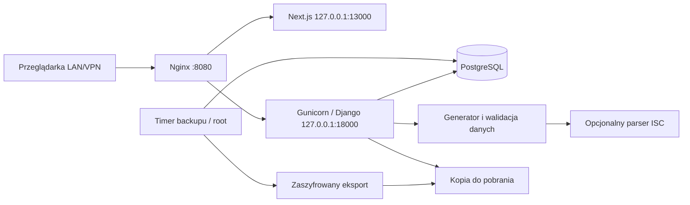

# Architektura i przepływ danych

Aplikacja jest serwerem WWW poza urządzeniem Check Point. PostgreSQL przechowuje konfiguracje, sesje i historię; niezależny generator Python tworzy plik. Nie ma Redisa, kolejki zadań, kontenerów ani połączenia administracyjnego z firewallem.

Nginx kieruje `/api/v1/` do backendu, stronę i zasoby do Next.js. Development używa 8000/3000 i proxy Next.js; E2E używa 8101/3101/3102 oraz oddzielnej bazy. Build `.next-quality` nie służy do instalacji. Dokładne porty i polecenia: [development](development.md), [installation](installation.md).

## Moduły i odpowiedzialności

| Moduł | Odpowiedzialność |
| --- | --- |
| `dhcp_tool/generator.py` | Whitelista, adresacja, dziedziczenie i deterministyczne bajty |
| `dhcp_tool/draft.py`, `draft_views.py` | Serializery, migawka i atomowa edycja z rewizją |
| `dhcp_tool/syntax.py`, `validation_views.py` | Adapter ISC i podgląd zapisanych danych |
| `dhcp_tool/history_views.py` | Publikacja, artefakt, diff i odtwarzanie draftu |
| `dhcp_tool/deployment_views.py` | Deklaracje wdrożeń, korekty i audyt |
| `dhcp_tool/csv_config_views.py`, `csv_views.py` | CSV całej konfiguracji i osobny wariant rezerwacji |
| `dhcp_tool/auth.py`, `access.py` | Sesje, CSRF, limiter, role i zakres firewalli |
| `dhcp_tool/backup_views.py` | Strumieniowe pobranie opublikowanego backupu dla admina |
| `frontend/src/components/workspace.tsx` | Nawigacja, kontekst firewalla i stan edycji |
| `frontend/src/components/csv-transfer.tsx` | Plik/tekst CSV, podgląd, potwierdzenia i zastosowanie |
| `frontend/src/lib/api/workspace-client.ts` | Klient sesji, CSRF, rewizji i błędów |
| `scripts/operations.py`, `publish-backup.py` | Eksport, restore, monitor i publikacja zaszyfrowanej kopii |

## Model i trwałość

Firewall ma jeden Draft i wiele Subnet, Version, Deployment oraz AuditEvent. Subnet ma maksymalnie jeden Pool i wiele Reservation. Konta lokalne mają Account z rolą; FirewallAccess nadaje zakres poza administratorem. Dane robocze mają UUID; adres IP rezerwacji jest unikalny w podsieci, CIDR w firewallu. Pełne reguły walidacji obejmują również nazwy/MAC i aktywne zakresy.

Draft przechowuje opcje globalne, rewizję i opcjonalne źródło odtworzenia `base_version`. Version przechowuje niezmienną migawkę oraz autora i metadane; Artifact — dokładne bajty i SHA-256. Wyzwalacze PostgreSQL chronią wersje i artefakty przed UPDATE/DELETE. Usunięcie danych roboczych nie zmienia historii. Deployment jest osobną ręczną deklaracją, z własną rewizją korekt.

Migracje: 0001 konta/zakres/limiter; 0002 domena i drafty; 0003 niezmienność; 0004 rewizja ewidencji. CSV nie wymagało nowej migracji. Konta autorów z historią dezaktywować zamiast usuwać.

## Edycja, podgląd, publikacja i wdrożenie

Edycja blokuje wiersz firewalla w transakcji, sprawdza `X-Config-Revision`, zapisuje dane, waliduje cały draft, zwiększa rewizję i zapisuje audyt. Awaria wycofuje całą operację; konflikt daje 409. Draft może być niekompletny podczas budowy konfiguracji. Walidacja gotowego pliku i publikacja wymagają aktywnej podsieci z jedną aktywną pulą.

Publikacja przechwytuje spójną migawkę pod blokadą, generuje i uruchamia parser poza transakcją, następnie ponownie sprawdza uprawnienia, sesję, archiwizację i rewizję. Wersja, artefakt i audyt zapisują się atomowo. Pobranie wersji zwraca zapisane bajty, bez ponownego generowania. Numery rosną osobno per firewall.

Podgląd CSV waliduje proponowany draft bez zapisu i wydaje podpisany token ważny 600 sekund. Zastosowanie ponownie sprawdza konto, firewall, rewizję i usunięcia, a następnie zapisuje całą partię oraz audyt. Pełny import zachowuje UUID i daty utworzenia istniejących podsieci/rezerwacji; może zmieniać metadane wyłącznie dla admina. Podgląd CSV nie uruchamia ISC. Po imporcie przejść do podglądu pliku i osobnej publikacji.

Publikacja, import, odtworzenie i pobranie nie tworzą wpisu wdrożenia. Ewidencja wybiera ostatnie udane zdarzenie według czasu zdarzenia, czasu wpisu i UUID, a nie numeru najnowszej publikacji. To deklaracja operatora, bez odczytu urządzenia.

## Bezpieczeństwo i utrzymanie

Backend kontroluje role i właściciela każdego zasobu. Sesje są w PostgreSQL; CSRF pobierany z JSON, konfiguracja pozostaje w pamięci panelu. API i błędy mają `no-store`; logi procesu nie zawierają body ani sekretów. Szczegóły: [security](security.md).

Timer root szyfruje eksport bazy i konfiguracji kluczem poza archiwum. Panel ma dostęp tylko do oddzielnej, zweryfikowanej kopii zaszyfrowanego pliku. Lokalny monitor kontroluje procesy, bazę, dysk i wiek/hash eksportu. Historia oraz backupy pozostają bez automatycznego usuwania. Dowody danych/ISC/Gaia są rozdzielone; więcej w [generatorze](generator.md) i [statusie](project-status.md).
